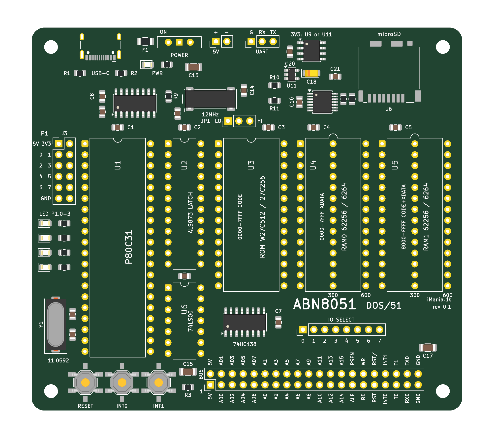

# ABN8051 hardware (rev 0.2, unrouted)

KiCad 10 project for the DOS/51 board described in [`../emulator/docs/HARDWARE.md`](../emulator/docs/HARDWARE.md): schematic, 100 × 89 mm floor plan and silkscreen. **No tracks are routed** and nothing here has been built or bench-tested.

## What is on the board

| Block | Parts | Notes |
| --- | --- | --- |
| CPU | U1 P80C31SFPN, Y1 11.0592 MHz, RC reset + button | EA tied low |
| Address latch | U2 SN74ALS873BNT (DIP-24) | as in the iMania breadboard guide |
| ROM | U3 W27C512 or 27C256 | CODE 0000–7FFF. JP1 sets pin 1: LO/HI half of a W27C512, HI for 27C256 (Vpp = 5 V) |
| RAM0 | U4 62256 (or 6264) | XDATA 0000–7FFF. Footprint takes a 600 mil or a 300 mil (skinny) DIP-28 |
| RAM1 | U5 62256 (or 6264) | CODE + XDATA 8000–FFFF. 600 or 300 mil, like U4 |
| Glue | U6 74LS00/74HCT00 | ~A15, RAM1 ~OE = ~RD AND ~PSEN, spare gate gives ~RST |
| USB | J1 USB-C (5k1 on CC1/CC2), F1 polyfuse, SW1, U8 CH340G, Y2 12 MHz MA-406 | 57600 8N1 console. R9 (1k) lets an adapter on J4 override the CH340 |
| microSD | J6 Hirose DM3CS-SF, U9 KF33 **or** U11 MIC5504-3.3 (3.3 V), U10 74LVC08 as 5 V → 3.3 V shifter | P1.4 CS, P1.5 SCK, P1.6 MOSI, P1.7 MISO, same as the emulator |
| I/O | J2 2×20 bus, J3 2×6 port 1, J4 UART, J5 I/O selects, J7 5 V | 2.54 mm headers |
| Optional | U7 74HC138 | ~IOn is low in 8 K block n (n × 2000h). Not qualified by a strobe |
| User | D1–D4 on P1.0–P1.3 (active low, JP5 disables), INT0/INT1 buttons, power LED | matches the DOS/51 examples. SW2–SW4 take a TL3342 or a 3×6 mm 2-pin SMD tact switch (iMania FC-003D-5.0) fitted 90° on the same centre |

Solder jumpers JP2–JP6 are on the **bottom**, each labelled next to its pads. JP2/JP3 select 62256 (pin 26 = A13, default) or 6264 (pin 26 = CS2 high; the 8 K then repeats through the 32 K block). JP4 moves RAM1's chip select from ~A15 to ~IO4 (8000–9FFF) so A000–FFFF is free for add-ons; this needs U7. JP6 connects the card-detect switch to T0.

## Things to check before ordering

- **FC-003D-5.0 land pattern** is borrowed from the XKB TS-1101 3×6 mm drawing (pad centres 7.5 mm); the FC-003D has no datasheet. Check the lead span of a real part against the 1:1 print.
- **U9 or U11, never both.** With the KF33 (U9) C18 must be the tantalum (KF33 needs output ESR 0.1–10 Ω); with the MIC5504 (U11, MLCC-stable) fit a 10 µF 1206 MLCC in C18's pads. C20 is 1 µF for both.

- **DM3CS-SF footprint** (`ABN8051.pretty`) was drawn from Hirose drawing EDC3-327223-03. Pin order and the detect/shell pad assignment were read from that drawing; print 1:1 and check against a real holder.
- **KF33 inhibit** (pin 5) is tied to GND on the assumption that low = on. ST's datasheet text does not state the polarity outright.
- **SW1** uses a generic 2.54 mm-pitch slide switch footprint (centre pin common). Fit any ≥ 300 mA part, or a wire link between pins 1 and 2.
- **P1.4–P1.7 are driven/loaded by the SD interface** (U10 drives P1.7 through 330 Ω), so on J3 they are monitor points rather than free GPIO.
- 22 pF is used on both crystals to keep one BOM line; the MA-406 is specified for 10 pF load, so 12–15 pF would be closer.
- U6 is listed as 74LS00 because that is what iMania stocks; 74HCT00 also works.
- LCSC numbers are in the `LCSC` field, iMania product ids in the `iMania` field (`ABN8051-BOM.csv`). On the DIP parts the LCSC number is the **socket** (as in the 65uino project), since the chips come from iMania stock.

## Regenerating

`tools/design.py` generated the schematic and `tools/pcbgen.py` the board. **Running `pcbgen.py` overwrites `ABN8051.kicad_pcb`, including any routing.** After the first manual edit, treat the KiCad files as the source and use Update PCB from Schematic instead.
